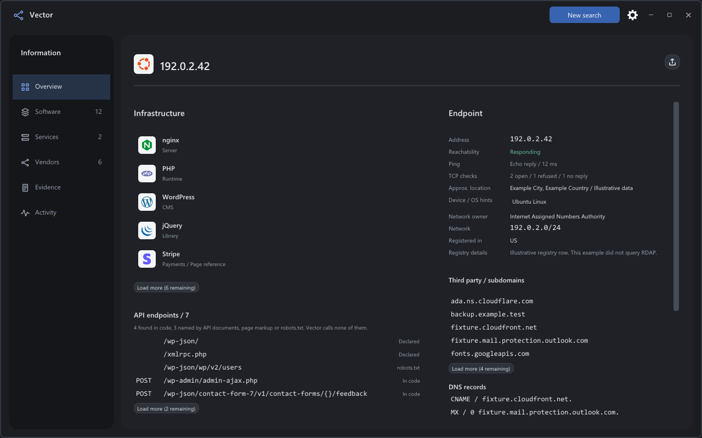

# Vector

Vector is a Windows desktop alternative to Nmap for focused service discovery and recon. Inspect one IP address, hostname, or HTTP(S) URL to identify exposed services, server software, website technologies, and infrastructure, with inspectable evidence for every match. Built in C++20 with SDL3 and a matching CLI.

## Download for Windows

**[Download Vector.exe](https://github.com/SeanDishman/Vector/releases/latest/download/Vector.exe)** for the desktop app. Download and run it; no installer, build tools, API key, or paid account is required. The release targets Windows x64 and statically links its application dependencies.

Prefer a terminal? Download **[vector-cli.exe](https://github.com/SeanDishman/Vector/releases/latest/download/vector-cli.exe)**. [All releases](https://github.com/SeanDishman/Vector/releases) include SHA-256 checksums and third-party license notices. Installed Microsoft Edge or Google Chrome enables automatic JavaScript analysis; static inspection remains available without a browser.

Vector focuses on a single endpoint and its web stack. It does not perform subnet sweeps, raw-packet OS fingerprinting, vulnerability assessment, or the full range of Nmap scans. See [scope and limits](#scope-and-limits).



Example report from offline demo mode; no network requests were made for this screenshot. See [public release verification](docs/public-release.md) for build and distribution details.

## Run

Open Vector.exe, enter a URL, hostname or IP address, and press **Enter** or **Inspect**. Vector chooses its checks from the address and uses bounded defaults. Settings contains only the optional proxy connection.

- A bare IPv4 or IPv6 address: inspect TCP 1–1024 plus common higher service ports automatically, then the supported device discovery protocols.
- A bare hostname: inspect 26 common TCP ports and the supported device discovery protocols.
- An explicit host:port: inspect the named port.
- An HTTP(S) URL: inspect its port only, preserving the URL, hostname and TLS SNI.
- IPv6: accepts ::1 or [::1]:8080.

During inspection, the process diagram shows the actual stages and the operation log displays returned information. **Cancel inspection** or Esc stops active checks and retains partial observations.

The completed overview contains **Infrastructure** and **Endpoint**. Infrastructure lists named technologies and attributed integrations (including supported video sources such as YouTube), followed by a separately labeled **Published providers** list when company disclosures are available. A separate **Info** section below Infrastructure lists service software, package versions, protocols and ports, including HTTP and HTTPS. Published relationships retain their source and date; they are not evidence that the provider's software ran on the endpoint. Endpoint shows ICMP/TCP reachability, approximate city/region/country, advertised device/OS hints, and available network ownership details. Select a result to inspect its evidence. Provider references, observed contact, requests the page made that got no response on this machine, and declared supported sources retain distinct labels. Reports open on **Overview** with the **Information** sidebar already visible: choose **Software**, **Services**, **Vendors**, **Evidence** or **Activity** directly. At narrower widths, software evidence sits below the results; Vendors keeps a narrower provider list beside the evidence.

**Third party / subdomains** appears below Endpoint. It lists collected subdomain links, browser responses, failed attempts, resource references and DNS hostnames with known provider names where evidence supports them. This list and **DNS records** each start with five compact rows; **Load more** reveals the next five. Double-click a row, or focus it and press Enter, to open its full evidence. **Back to connections** returns to the lists. DNS details expose system-resolved A/AAAA addresses and returned CNAME, MX, NS and TXT values with their source, TTL and collection time. Unknown providers and failed lookups remain visible. This view makes no extra requests and does not enumerate all subdomains. See [endpoint connections](docs/endpoint-connections.md).

**API endpoints** appears under Infrastructure. It lists the URLs the site's front end calls or names, starting with five compact rows; **Load more** reveals ten more. *Observed* rows are requests the page's own code made in Vector's isolated browser (XHR, fetch, event streams, beacons and WebSocket connections) that received a response; *Attempted* rows received none. *Answered* marks a JSON reply to one of Vector's own page reads. *Described* rows come from an OpenAPI or Swagger document the inspection already collected, *Declared* rows from page markup (a WordPress REST link, an API-shaped form action or an htmx request attribute), *In code* rows from string literals in collected scripts, and *robots.txt* rows from that file. Vector sends no request to a listed endpoint, so only Observed and Answered rows are confirmed to respond; a code reference can be inactive code or a bundled library's own endpoint. Query strings are omitted, identifier-like parts of observed URLs appear as `{id}`, and `{}` marks a value the code fills in at run time. A path shown without a host means the code did not state one. Double-click a row, or focus it and press Enter, for its evidence; **Back to API endpoints** returns to the list. JSON, CSV and TXT exports carry every row. See [API endpoints](docs/api-endpoints.md).

A normal launch makes no requests until you start an inspection. **New search** (header, on a completed report) or Ctrl+L returns to address entry; Tab and Shift+Tab navigate controls. The sidebar contains report sections only; Recent inspections and its scrollbar have been removed. Export a report before starting another inspection if you want to keep it. The integrated window header supports dragging, resizing, minimize, maximize/restore and close.

Public hostname inspections also read **CNAME, MX, NS and TXT** records through Google Public DNS over verified HTTPS. Four concurrent requests share a three-second limit, with 64 KiB and 64 records per response. Hosting aliases, inbound mail, authoritative DNS and SPF sending authorization appear with their exact records, TTL, resolver and date. Published SPF includes name the sending service (for example Amazon SES, SendGrid, Mailgun, Zendesk, Salesforce, Pardot, Brevo or Proofpoint) as an email authorization, not as proof of delivery or account activity. Alias, nameserver and mail-exchanger targets are matched against the provider's own DNS zones (for example Akamai, Fastly, Netlify, Amazon Route 53, Google Cloud DNS, Mailgun, Proofpoint or Mimecast); the bare zone name and lookalike names do not match. Verification TXT tokens alone do not identify a technology. IP inputs and names resolving to local/reserved addresses skip this lookup. An exact leading `www.` is removed for MX/NS/TXT queries; other subdomains keep their own scope. This metadata stage is separate from the web budget. Full results are under **Evidence → Domain DNS**. See [DNS infrastructure](docs/dns-infrastructure.md).

**Export report** offers **JSON**, **CSV**, and **TXT**. Each saves the complete report, including all findings and evidence, endpoint details, provider relationships, browser/script coverage, notes, and activity. The selected view and filters do not limit the export. Files are saved in `reports` beside `Vector.exe`, with the saved path shown in the app. Exporting only saves the existing report; it makes no requests. Partial, failed and example reports keep their status. [Export formats](docs/report-export.md) describes the CSV columns and text layout.

Certificate verification is always enabled in the desktop flow. Installed Edge or Chrome automatically executes an eligible page in a fresh temporary profile so dynamically loaded scripts and external dependencies can be identified. If its document request fails after a successful static read, it can execute that complete collected HTML with security headers retained. The original rejection and captured-document fallback are labeled separately in **Evidence**. Unavailable browsers are explicit there. The CLI retains controls for custom ports, timeout, static-only inspection and untrusted certificates.

Additional [web signatures](docs/web-signatures.md) combine advertised runtime versions with matching API properties, inspect structured DOM markers, corroborate framework cookie names and extract versions from complete library license comments. Every match retains its rule ID, revision and supporting evidence. Each DOM selector checks at most 64 elements and reports when limited. Cookie values are neither matched nor exported by these rules. The original rule definition is embedded at build time; these checks reuse collected evidence within the existing browser and web budgets.

**Vendors** identifies third-party references, browser responses and published company providers. Published names are extracted from documents collected during the inspection; no company name catalog ships in Vector. Discovery follows labeled subprocessor, privacy, legal, compliance and trust links, including explicitly linked HTTPS trust centers. Tables and structured provider cards retain their source, date, scope and discovery chain. One linked JavaScript source can be rendered when static HTML is insufficient. Collection stays within four disclosure transfers, five seconds of transfer time and the shared 12-page/30-second web cap. Failed or unsupported sources remain visible and supply no fallback names. These relationships do not establish account access. Read [published-provider collection](docs/published-providers.md), [vendor evidence](docs/vendors.md) and [browser execution](docs/browser-runtime.md).

[Interface research and behavior](docs/interface-redesign.md) explains the simplified workflow and design sources.

Bundled **core-js** version records and paired **Twilio Segment** package markers identify code even when its URL is renamed or proxied. Ketch, Datadog RUM, ipify and OneTrust autoblocker resource paths also supply attributed evidence. Browser collection permits up to 160 script attempts while retaining the existing request, byte and time bounds. See [consumer detection fixes](docs/consumer-detection-fixes.md).

The [nine-site detection expansion](docs/coverage-expansion.md) adds paired code markers for Vue, Vue I18n, Lucide, DOMPurify, Pako, rlottie, dotLottie, Sentry, Headless UI, Floating UI, ttag, Turbopack, Prebid and the Google Tag Manager loader, plus Bulma CSS and Apache Traffic Server headers. Narrow service endpoint rules identify additional advertising and measurement contacts. Each match retains its evidence; provider contacts do not establish account access or an ad impression. Large sitemaps are queued without repeatedly parsing every earlier link, preserving the existing priorities and scan limits.


## Proxy

Open **Settings**, enable **Use a proxy**, and enter its host/IP, port and optional username/password. There is no proxy type to choose: when an inspection starts, Vector asks the proxy how it answers and uses it as an HTTP, HTTPS or SOCKS5 proxy accordingly. If the address does not answer as any of them, the inspection stops with that message and nothing is sent directly. A whole proxy can also be pasted into Host or IP as `host:port`, `host:port:username:password` or a proxy URL with percent-encoded credentials. **Save proxy** applies it to new inspections; saving does not connect. Windows protects saved credentials for the current user. Turn the setting off and save to connect directly again.

TCP checks, HTTP(S), browser dependencies, provider documents and HTTPS metadata requests use the proxy, with no direct fallback. Hostnames are resolved by the proxy; Vector does not report the proxy's address as the target IP. ICMP and UDP discovery are skipped, and IP registry/location lookups require a known numeric target. A proxy may restrict the ports it permits. Target TLS verification and proxy TLS verification remain separate; the target's untrusted-certificate option never disables proxy verification.

CLI: `vector-cli --target https://site.example --proxy proxy.example:8080 --proxy-user USER --proxy-password PASS`. The type is detected the same way; an `http://`, `https://` or `socks5://` prefix skips detection and forces that type (`socks5h://` and `all://` are accepted too). SOCKS5 uses remote DNS. CLI proxy configuration is explicit and does not load desktop settings. Reports include the proxy endpoint and whether authentication was configured, never the username/password.

## Build on Windows

Requirements: CMake 3.24+, a C++20 compiler (MinGW-w64 or MSVC), Ninja for the helper script, and network access on the first build. Python 3 and the test dependencies below are needed for integration tests. Node.js enables the runtime-observer test; installed Edge or Chrome enables browser integration tests.

```powershell
python -m pip install -r tests/requirements.txt
./scripts/build.ps1
```

The script configures, compiles, runs tests, and creates `dist/Vector` with both executables, documentation, and dependency licenses. Dependencies are downloaded at pinned release versions and built statically. No paid services or API keys are needed.

For separate configure, build, and test steps, keep compilation inside the repository's build lock and use at most two workers:

```powershell
./scripts/with-build-lock.ps1 -Command @('cmake', '-S', '.', '-B', 'build', '-G', 'Ninja', '-DCMAKE_BUILD_TYPE=Release')
./scripts/with-build-lock.ps1 -Jobs 2 -Command @('cmake', '--build', 'build', '-j', '2')
ctest --test-dir build --output-on-failure
```

Some standalone Windows CMake distributions have no CA bundle configured. The helper discovers Git for Windows' bundle and supplies `CMAKE_TLS_CAINFO`; it never disables download verification. MSVC users should run in a Developer PowerShell or choose a Visual Studio generator manually.

Linux/macOS: configure with CMake and install OpenSSL development headers. The source has POSIX socket support, but this delivery is verified on Windows only. `-DVECTOR_BUILD_GUI=OFF` builds just the engine, CLI and tests.

## CLI

```powershell
./build/bin/vector-cli.exe --target host.example
./build/bin/vector-cli.exe --target host.example --ports 22,80,443,8000-8010
./build/bin/vector-cli.exe --target https://host.example --web-only --output report.json
./build/bin/vector-cli.exe --target https://host.example --web-only --allow-untrusted-tls
./build/bin/vector-cli.exe --demo
```

JSON goes to stdout; progress goes to stderr. Exit codes: `0` inspection completed (individual requests can still fail), `1` fatal inspection failure, `2` invalid arguments or file errors, `130` cancelled. `--timeout` is the TCP timeout in milliseconds; `--http-timeout` controls each static web request. `--no-browser` disables JavaScript execution. `--browser-timeout N` sets the browser observation window (1,000–30,000 ms, default 12,000). Ctrl+C requests cancellation.

## Scope and limits

- Reachability: Windows sends one ICMP/ICMPv6 echo to the selected IP (750 ms maximum). The report shows echo replies and latency separately from TCP open/refused/no-response outcomes and UDP replies. No response means unknown, not offline. A refusal can be produced by a firewall. Other platforms explicitly report ICMP as unavailable. Cancellation can wait up to 750 ms for the single echo.
- Approximate location: one HTTPS lookup to [ipwho.is](https://ipwhois.io/documentation) for the selected public IP, capped at three seconds and 32 KiB; no redirects, cookies, credentials or retries. Private, local and reserved addresses are not sent. City, region, country, source and lookup date are retained. This is an IP estimate, not a physical device or street location. RDAP registration country is shown separately. Lookup failures and rate limits remain visible. The ICMP, registry and geolocation checks precede the separate web collection budget.
- One resolved address is inspected per run, preferring IPv4; all returned DNS addresses are listed. Enter another IP to inspect it. Target connections retain the original host name and are pinned to that address; www redirect destinations, browser dependency hosts and permitted related disclosure hosts use their own DNS results. Each web response retains its destination URL and address.
- Common coverage is TCP 21, 22, 23, 25, 53, 80, 110, 135, 139, 143, 443, 445, 554, 631, 993, 995, 1883, 3389, 5000, 5900, 5985, 5986, 8000, 8080, 8443 and 9100. Silent ports get one probe matched to the protocol (SMB2 negotiate, RDP X.224, TLS ClientHello, Redis PING, PostgreSQL SSLRequest, and the same idea for DNS, MQTT, AMQP, FTP, SMTP and SSH). An unmatched silent port gets a single `GET / HTTP/1.0`. A match is the reply, never the port number. When an HTTP response advertises NTLM, Vector sends one Type1 negotiate and records NetBIOS/DNS computer and domain names from the Type2 challenge (NTLMRecon-style identity, not authentication). Ports 5985 and 5986 are treated as HTTP(S) so WinRM endpoints that speak Microsoft-HTTPAPI are named.
- Deeper IP coverage: all TCP ports 1–1024 plus selected higher service ports, including 3306, 5432, 6379, 11211 and 27017. Common services run first. Up to 32 TCP connections run at once for bare IPs; other selections use up to eight. This is a bounded selection, not all 65,535 ports. Explicit URLs, host:port, `--web-only` and custom `--ports` retain their requested scope. Custom lists remain capped at 256 ports. The JSON `tcp_coverage` records the profile, exact selected ports, planned/completed counts and concurrency bound. TCP checks precede the separate web time budget. [Port coverage](docs/ip-port-scan.md) lists the complete selection.
- Static collection: bounded banner reads, eight open web ports, four requests per redirect chain, 1 MiB per page, 64 KiB of response headers. The same-host crawl shares a limit of 12 page attempts across all web ports (in-page links, robots.txt sitemaps, sitemap.xml); redirects and failures count. Up to 40 unique declared scripts across the whole inspection are read for library signatures, with 512 KiB analyzed per response: the page host's own scripts first, then scripts the page declares on other hosts (module preloads included). A read on another host stays in the page's address scope: a public page reads public hosts only, checked on the connected address after DNS, and a loopback or private page causes no outside request. Those reads always verify TLS, wait at most four seconds, follow no redirects, do not repeat a script the browser already analyzed and do not retry an endpoint that failed to answer. Through a proxy only public-form names and public IP literals are read. Scripts on a different port of the inspected host are identified by URL only. The static collector follows the exact www hostname alias after a redirect, and the entered page's own redirect to another hostname inside the same address scope. An HTML document answered at a sitemap-named path is analyzed as a page. Entry pages are inspected before crawl links; linked documentation landing pages then precede robots.txt and ordinary links, with guessed sitemap paths used afterward. Bare hosts prefer HTTPS on 443, while explicit targets retain their requested endpoint.
- Browser collection: one eligible entry page per web endpoint executes JavaScript; a rejected or failed static read also gets an independent browser attempt, including loaders and dynamic imports. Dependencies may come from other hosts. A fresh installed Edge/Chrome session observes up to 256 requests, 160 script bodies with up to 2 MiB analyzed each and 32 MiB of transfers per page. Browser response streaming retains at most the first 2 MiB, including from larger bundles. Up to eight already-loaded text/css responses per page are analyzed with a 512 KiB prefix, including stylesheets from dependency hosts; no extra network request is issued for these bodies. Rendered resource elements retain page-reference evidence independently of whether a network response succeeded. Reference parsing accepts up to 3 MiB of retained markup and 8,192 tags per document, with 256 relationships per report. If streaming is unavailable, bounded body retrieval accepts at most 4 MiB; larger bodies remain explicitly unavailable. Default observation is 12 seconds, shortened by a shared 30-second web collection budget including static reads and browser startup. Cleanup and report analysis can add brief overhead. No clicks, scrolling or login. Failed, skipped, unavailable and limited coverage is retained. See [browser limits](docs/browser-runtime.md) and [web evidence caps](docs/web-evidence-cap.md).
- Published providers: names come from supported structured rows in successfully collected company disclosure documents. Discovery follows explicit subprocessor, privacy, legal, compliance and trust links, including explicitly linked HTTPS hosted trust centers. Short document labels and relevant path segments qualify; unrelated showcase slogans and marketing articles do not. At most four disclosure transfers, five seconds of transfer time, depth four and one rendered source share the 12-page/30-second caps; documents are capped at 3 MiB. Every extracted row retains its publisher, scope, source and date. No bundled company/provider catalog or automatic StackFull API call supplies names. Failed or unsupported documents remain explicit.
- Linked documentation page: when the entered page links to documentation on another host of the same site (a `docs`, `documentation`, `developers` or `developer` subdomain, or a `docs` or `documentation` path that redirects to another host), Vector reads that one page after the entered site and runs it in the isolated browser. It has three requests of its own, takes none of the 12 page attempts of the entered site and shares the 40-script and 30-second limits, so it only uses time that is left. Another host must be in the same address scope and its TLS is verified. Nothing else on that host is read, paths are never guessed, and names first seen there are marked with that host on the Overview and listed under `linked_pages` in the JSON.
- Full HTTP(S) endpoint collection is still only for known web ports or the specifically entered endpoint. A probe that answers with HTTP is then read the same way. Port 9100 receives no payload, including when entered explicitly. Endpoint redirects may add or remove the exact www label, resolving that destination separately. If the entered page redirects to another hostname, as a moved site does, Vector follows it for web evidence (at most two hostnames, same address scope, verified TLS) and keeps the destination's URL and address on that evidence. Redirects to other hostnames met later in the crawl, unrelated non-web ports and HTTPS downgrades are recorded without following them; the separately labeled disclosure collector permits only the related hosts described above.
- TLS validation is on by default and proxies are disabled. Static reads send no cookies or credentials. The isolated browser can send page-initiated requests and use temporary cookies; no personal browser profile or saved credentials are used. Exported Set-Cookie values are redacted and response bodies are omitted. Runtime request headers, bodies, cookies and URL query values are omitted. Reports still contain hostnames, paths, addresses and server-provided metadata.
- Device and OS results are advertised hints. An IP can front NAT, CDN, virtual hosting or load balancers; it cannot reliably reveal physical hardware. A full host inspection also sends UDP identification probes: SSDP M-SEARCH (`ssdp:all` and InternetGatewayDevice) to port 1900, an mDNS PTR query to port 5353, and an SNMPv2c sysDescr get on port 161 using the community name public. SSDP retains up to eight distinct replies from the inspected address in a default 1.5-second window. Same-host `LOCATION` device descriptions (at most two, 64 KiB) add manufacturer/model/friendly-name evidence. A private LOCATION on a public target is recorded without fetching. This identifies the gateway endpoint. It does not sweep a subnet. NAT port mappings, SNMP ARP rows, and a TR-064 host table (at most 32 entries) are kept only when the gateway itself returns them. An empty result is not a full LAN map. Explicit-port, custom-port and web-only runs skip those probes. There is no ARP/subnet sweep, raw-packet OS fingerprinting, MAC/OUI lookup, authenticated inventory, vulnerability assessment or Nmap integration in this version.
- Cancellation interrupts TCP waits and HTTP transfers. The initial system DNS lookup uses the OS resolver and may finish on the OS timeout before cancellation returns.
- SDL/ImGui offers keyboard navigation, but this renderer does not expose full native screen-reader semantics.

Use on systems you own or have permission to inspect.

Read [the research notes](docs/research.md) for the identification methods, sources, and extension points. The tests use local fixtures, including a deliberately untrusted TLS certificate; they do not scan public targets.

See [verification results](docs/verification.md) for the build, transport fixtures, native UI checks and packaged executable tests.

Library detection and script coverage are described in [library identification](docs/library-identification.md). Raw comparison fingerprints remain in the full report and are excluded from the named-software overview.


Frontend evidence: paired React Router/Remix hydration assignments, Radix component attributes and structured Statsig bootstrap configuration can identify libraries without readable asset filenames. Renamed bundles are matched by paired implementation markers in code, never by a package name in a string: Motion (Framer Motion), Base UI, Datadog Browser SDK, TanStack Query, TanStack Router, Intercom Messenger and Highlight.js, plus the React version stated by the react-dom renderer registration. A ten-site comparison added the same kind of rule for Turbopack production chunks, Lucide's React build, Statsig, Kasada, styled-components, Emotion, Sanity, Svelte, three.js, PostHog, Apollo Client, RudderStack, Sift, web-vitals, Vercel Speed Insights, Vercel Web Analytics and the OneTrust stub. Versions appear only where the library states one next to its marker. A `style` element carrying styled-components or Emotion attributes, `/_astro/` asset paths, a KaTeX stylesheet's font face and version rule, the `x-envoy-upstream-service-time` header, documented Sanity, Google Hosted Libraries, OneTrust and hCaptcha resource hosts and Amazon S3 endpoint host forms are also recognized. See `docs/stackfull-parity.md`. Tag configuration (`src/tag_config.hpp`): a `gtag('config', ...)` call in code next to the documented queue function names Google Analytics, Google Ads or Floodlight from its destination ID, and a Google tag container body (the `var data = {"resource": ...}` envelope, whichever host serves it) names its configured destination IDs, Google's own built-in tag types and the documented provider behind each URL in a custom HTML or image tag. These are configuration: the evidence says the tag was configured, not that it fired. Other built-in tag types are not mapped. The same file names a destination from a `window.gtag(...)` or `globalThis.gtag(...)` call with the `config` or `get` verb and a literal ID, a Google destination ID stored under a configuration key such as `measurementId`, `googleAnalyticsCode` or `googleAdsCode`, and the LinkedIn Insight Tag from a numeric `_linkedin_partner_id` set next to `_linkedin_data_partner_ids`. See `docs/ten-site-validation.md`. `src/tracker_providers.inc` adds documented analytics, advertising, consent, chat, payment, identity, video and delivery endpoints, each with its source. See `docs/tag-evidence.md`. A Bybit comparison added response-header rules for OpenResty (`server`), Akamai (`server: AkamaiGHost`, `x-akamai-transformed`) and an Amazon S3 origin (`x-amz-id-2`), paired Akamai Bot Manager cookie names (`_abck` with `bm_sz`), the decimal.js license banner, Splide's stylesheet rules, paired code markers for i18next, Day.js and Sensors Analytics, the release Next.js states in `window.next` and prerelease React versions stated by the react-dom renderer registration. A ten-site round then made every script rule accept backtick-quoted literals, because some bundlers write all strings that way, and added markers for Radix UI (its own `window[Symbol.for("radix-ui")]` registration, or its slot symbol with its identity check or focus guard), MobX, RxJS, Loadable Components, Cloudflare Zaraz, Rive (from its embedded package metadata, with version), Segment bundled from npm, compiled Lucide icons, lodash internals, the Base UI error helper, the React Router version global, Redux action types, the Optimizely and mParticle SDKs (with the release each states), RequireJS and the Algolia client. The hCaptcha loader is matched by its `hCaptchaOnLoad` hook name together with its `recaptchacompat` query forwarding. web-vitals, Sanity, PostHog and Apollo Client rules accept the forms newer minifiers produce. An `iframe` element built in page code with a YouTube embed address is named "YouTube embed"; a link, a thumbnail address or an embed address outside the element is not. Ordinary static page bodies allow 1 MiB so larger JSON bootstraps do not automatically cut off trailing scripts. Up to eight declared stylesheets (512 KiB each, at most 128 references) are checked for original Tailwind CSS and Bootstrap signatures within the shared 30-second web deadline: the page host's own first, then stylesheets declared on other hosts under the same address-scope rule as scripts. Stylesheet reads take at most 1.5 seconds each and follow no redirects or imports. MIME failures, truncation and cancellation are retained in Activity, Evidence and exports. Bootstrap configuration is advertised evidence, not proof of private backend execution. See `docs/frontend-evidence.md`.
