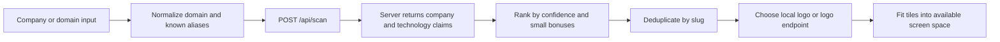

# Stackfull: public-client reconstruction and detection evidence

Captured 2026-11-09 UTC. This extends the earlier [service investigation](stackfull-research.md) and [Google trace](stackfull-google-trace.md). It does not change Vector's production detector.

The complete JavaScript set explicitly linked by the captured homepage, Stats and Sponsor documents was recovered: **10 files, 778,916 bytes**. Nine were observed in a fresh headless browser and one additional preload was retrieved from its document link. Every file has a readable, formatted counterpart. The main application chunk is byte-identical to the earlier capture.

**The private detector was not recovered.** The shipped client submits a domain to a server, then displays the returned inventory. None of the captured chunks advertises a source map; the conventional map URL for the application chunk returned HTTP 403 and was not pursued. No public backend repository was located. These observations do not reveal the server's complete rules, upstream services, model use, caching, execution environment or crawling strategy.

## What the public code actually does

The [main application bundle](https://www.stackfull.lol/_next/static/immutable/chunks/3lavt10la-_mm.js) contains its presentation code, a Matter.js physics implementation and static metadata. Its lookup path is:



1. Trim and lowercase the input. Recognize known company aliases; otherwise parse a URL, remove `www.`, and append `.com` to a remaining name without a dot.
2. Submit `POST /api/scan`, with `Content-Type: application/json` and a body containing only the normalized `domain`.
3. Read company metadata and `items` from the response. A newer lookup invalidates an older response through a request counter. Errors produce an error state; this path does not fall back to a local detection engine.
4. Sort each item by `confidence + 0.5 if a bundled logo exists + 0.3 if source is not detected`. Keep the first item for each slug.
5. Use `/logos/{slug}.png` when a logo is bundled. Otherwise use `/api/logo/{encodedSlug}?v=4`, adding the item's website as `u` when present.
6. Convert the result to tiles containing name, slug, logo, category, purpose and website. **Source and confidence are not passed to the displayed tile data.** Detected, published-provider and curated claims therefore appear together in the same visual treatment.
7. Fit tiles to the available area. The total is the deduplicated inventory; the shown count is the number that fits. A smaller shown count is not a separate detection result.

Recovered pure logic is in `docs/reports/stackfull-reverse-engineering/client-core.mjs`. It reconstructs normalization, request construction, ranking, deduplication, logo selection and tile projection. It performs no network requests and is not imported by Vector.

## The bundled data

The captured application ships:

| Data | Count |
| --- | ---: |
| Technology metadata records | 115 |
| Categories | 18 |
| Company profiles | 25 |
| Company-to-tool associations | 255 |
| Associations labeled detected | 131 |
| Associations labeled subprocessor | 74 |
| Associations labeled curated | 50 |
| Logo slugs supplied in the homepage | 138 |

Technology records contain names, aliases, categories, purposes, websites and colors. They are a metadata catalog, not a complete set of matching rules. Company records contain tool lists with source labels. The client constructs company-response objects with fixed confidence values of 97 for subprocessors and 90 otherwise; that map expression's result is not used by the observed successful lookup path. The company array supplies the alias map. Its presence does **not** establish that the server uses this same data as a cache or fallback.

Readable application locations:

| File and line | Responsibility |
| --- | --- |
| `readable/3lavt10la-_mm.js:2882` | Category metadata |
| `readable/3lavt10la-_mm.js:2956` | Technology metadata |
| `readable/3lavt10la-_mm.js:3877` | Company profiles and tool associations |
| `readable/3lavt10la-_mm.js:4878` | Static company-response construction |
| `readable/3lavt10la-_mm.js:4905` | Company alias lookup |
| `readable/3lavt10la-_mm.js:5563` | Domain normalization and scan request |
| `readable/3lavt10la-_mm.js:5585` | Ranking, deduplication and tile fields |
| `readable/3lavt10la-_mm.js:5795` | Total versus shown counts |
| `readable/36kzr1j87xoi4.js:1067` | Shared URL-normalization helper |

The other application endpoints visible in the shipped code are `/api/logo/…`, `/api/brand` and `/api/ads/checkout`. The last two support sponsor onboarding. Checkout was not invoked; they do not expose the technology detector's implementation. Stats describes its own visitor analytics as DataFast; this is not evidence that DataFast supplies stack detection.

## What explains the larger result sets

The following are Stackfull's classifications, not independently verified inventories. YTMP3 is a fresh browser lookup from this investigation; the others are earlier saved responses whose main client bundle matches this capture.

| Lookup | Returned items | Detected | Subprocessor | Curated |
| --- | ---: | ---: | ---: | ---: |
| ytmp3.gl | 2 | 2 | 0 | 0 |
| google.com | 171 | 3 | 168 | 0 |
| linear.app | 55 | 19 | 35 | 1 |
| youtube.com | 19 | 11 | 8 | 0 |

For Google, almost all of the large inventory consists of published-provider claims. Its sources include Google's Cloud, Workspace and Chrome Enterprise subprocessor documents. These name contractors and affiliates that need not appear in a browser session or on the inspected endpoint. The [earlier Google analysis](stackfull-google-trace.md) retained exact source rows and also identified one returned table-header label that was not a provider.

The API retains a report-level sources list but these responses contain no matched bytes or item-to-source mapping. Its numeric confidence values recur in a few fixed buckets; the public client offers no calibration explaining them as probabilities. The internal `stack://detector/40` source is an opaque identifier, not a public source document or proof of a particular rule count.

## YTMP3 and the Wappalyzer clue

The fresh normal lookup returns **YouTube** and **Nginx**, both labeled detected with confidence 88. A separate read of the cited [YTMP3 homepage](https://ytmp3.gl/) received `Server: nginx`. Its form has a YouTube URL placeholder and the page describes a YouTube conversion service.

Both returned descriptions and website URLs exactly match the corresponding public records in the [Wappalyzer-derived y.json catalog](https://github.com/enthec/webappanalyzer/blob/main/src/technologies/y.json) and [n.json catalog](https://github.com/enthec/webappanalyzer/blob/main/src/technologies/n.json). This is evidence of shared metadata wording. It suggests catalog reuse somewhere in the data path, but **does not prove Stackfull runs Wappalyzer or uses its matcher unchanged**.

That distinction matters here: the referenced YouTube rule looks for embedded players or YouTube script URLs. None of those signals matched the captured static YTMP3 homepage. Its YouTube form placeholder supports a **supported input/source** relationship. The unseen server could use other pages, runtime observations, different rules or another enrichment source; the response does not disclose which. The Nginx header is directly observable. YouTube being labeled a framework in Stackfull's response also should not become Vector's classification by default.

## Concrete implications for Vector

Vector already has bounded browser execution, static and loaded-script analysis, header evidence, runtime checks, vendor relationships and published disclosures. Adding a second browser collector alone would not address the difference shown here.

| Coverage area | What this investigation establishes | Vector implementation direction |
| --- | --- | --- |
| Named technologies | The useful inventory comes back from the server; its full matching corpus is not in the client. Shared catalog wording is visible. | Measure missing products against saved positive and misleading-negative fixtures. Extend structured rules and canonical identities instead of treating every logo or prose mention as a detection. |
| Integrations and supported sources | YTMP3 explicitly accepts YouTube links even without a matching player embed in the captured page. | Represent supported sources/capabilities with the exact form evidence; distinguish them from observed network integrations. Vireo is handling this area separately. |
| Company providers | Published lists account for most entries in the saved Google response and much of Linear's. | Expand disclosure discovery and extraction while retaining publisher, document scope, date and original cells. Existing collectors can supply this layer. |
| Recognizable names and logos | The client joins stable slugs to canonical metadata and logos. | Keep technology identity and icons consistent across evidence types. Saffron is handling icons separately. |
| Display | Stackfull puts its different evidence types into one familiar grid. | Show useful technology/integration names prominently, with technical protocol details in Info and provenance available. Tamarack is handling the split separately. |

The key comparison is coverage of named technologies and relationships, not the raw count of open ports, libraries, subsidiaries and corporate providers combined. Copying the private matcher cannot be justified from this capture because its source was not delivered. The recovered client and API observations provide concrete inputs for a coverage benchmark and UI mapping without pretending that unknown backend code has been obtained.

## Evidence and verification

Artifacts are isolated in `docs/reports/stackfull-reverse-engineering/`:

- `assets/` and `readable/`: original public JavaScript and formatted counterparts.
- `capture-manifest.json`, `public-sources.json`, `linked-assets.json`: response metadata, URLs, sizes and SHA-256 hashes.
- `ytmp3-lookup.json`: the fresh lookup request's original response; its request body is recorded in the browser manifest.
- `extracted-catalog.json`, `extracted-companies.json`, `extracted-categories.json`: data-only extraction, with no captured JavaScript evaluated.
- `analysis.json`: counts, source distributions, metadata comparisons and source observations.
- `client-core.mjs`: readable reconstruction of the pure client behavior.
- `verification.json`: one focused offline consistency pass, checking 23 artifact records, all 10 linked JavaScript files, 67 input-normalization cases and ranking of 247 items from four responses, plus duplicate-slug and logo behavior.

The initial browser recorder used colliding filenames for document and RSC prefetch responses. The original manifest is preserved as `browser-manifest.original.json`; overwritten entries are explicitly listed as omitted in the canonical manifest. Fresh document captures have separate names and hashes. The recorder now excludes RSC prefetches from document filenames. No omitted capture is used as verified evidence.

Re-run offline analysis and verification with:

```powershell
python docs/reports/stackfull-reverse-engineering/analyze_client.py
node docs/reports/stackfull-reverse-engineering/verify_capture.mjs
```

No live target inspection was run through Vector, no personal browser profile was used, and no production source or peer change was modified. One normal Stackfull lookup was submitted. Backend availability and exact detection rules remain explicit limits of this reconstruction.
